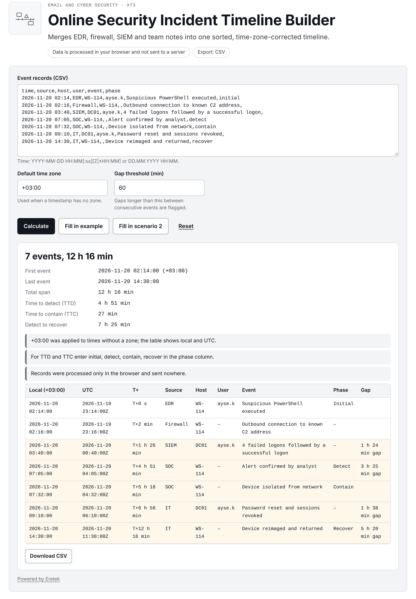

# Security Incident Timeline Builder

Merge incident records from different sources with time zones normalized; get a timeline with detection and containment times and logging gaps as CSV.

## Try it live

- [Türkçe](https://siberguvenlik.eretek.com/araclar/guvenlik-olayi-zaman-cizelgesi)
- [English](https://siberguvenlik.eretek.com/en/tools/incident-timeline-builder)
- [Deutsch](https://siberguvenlik.eretek.com/de/werkzeuge/vorfall-zeitleiste)



## What it does

Merges EDR, firewall, SIEM and team notes into one sorted, time-zone-corrected timeline.

After a security incident the answers to 'when did it start, when did we notice, when did we stop it' are spread across systems logging in different time zones. The tool converts timestamps to UTC, sorts events, shows elapsed time from the first event (T+) and long logging gaps; with a phase column it calculates time to detect (TTD) and time to contain (TTC).

## Where it helps

Attach the timeline to the incident report and lessons-learned meeting; gaps reveal missing log coverage, long TTD reveals monitoring issues. Pass fields with personal data through the Log Masking tool before sharing.

## How to use it

1. CSV header: `time, event` required; `source, host, user, phase` optional. phase: initial, detect, contain, recover (TR/DE equivalents accepted).
2. Enter the offset (e.g. +03:00) for timestamps without a zone and the gap threshold (minutes).
3. Press Run; attach the timeline as CSV to the incident report.

### Fields

| Field | Description |
|---|---|
| Event records (CSV) | Time: YYYY-MM-DD HH:MM[:ss][Z\|±HH:MM] or DD.MM.YYYY HH:MM. |
| Default time zone | Used when a timestamp has no zone. |
| Gap threshold (min) | Gaps longer than this between consecutive events are flagged. |

## Example input

Press **Fill in example** in the tool to load this input.

| Input | Value |
|---|---|
| Default time zone | `+03:00` |
| Gap threshold (min) | `60` |

**Event records (CSV)**

```text
time,source,host,user,event,phase
2026-11-20 02:14,EDR,WS-114,ayse.k,Suspicious PowerShell executed,initial
2026-11-20 02:16,Firewall,WS-114,,Outbound connection to known C2 address,
2026-11-20 03:40,SIEM,DC01,ayse.k,4 failed logons followed by a successful logon,
2026-11-20 07:05,SOC,WS-114,,Alert confirmed by analyst,detect
2026-11-20 07:32,SOC,WS-114,,Device isolated from network,contain
2026-11-20 09:10,IT,DC01,ayse.k,Password reset and sessions revoked,
2026-11-20 14:30,IT,WS-114,,Device reimaged and returned,recover
```

**Expected result:** 7 events over 12 h 16 min; first sign at 02:14, analyst confirmation at 07:05: time to detect 4 h 51 min, containment 27 min. Four long gaps flagged.

## Method and assumptions

If a timestamp contains Z or ±HH:MM it is used, otherwise the default zone applies; sorting is by UTC, ties keep input order.

TTD = first 'detect' − first 'initial' (or first event). TTC = first 'contain' − first 'detect'. Gap = time between consecutive events > threshold.

## Limits and common mistakes

- Accuracy of source system clocks (NTP drift) is unknown; sub-second ordering is not exact. Daylight saving changes must be entered via the offset.

## Run it locally

The tool is plain HTML, CSS and JavaScript with no build step and no dependencies.

```bash
git clone https://github.com/eretek/incident-timeline-builder.git
cd incident-timeline-builder
node scripts/serve.js        # or: python3 -m http.server 8080
```

Open <http://127.0.0.1:8080/>. Add `?lang=tr` or `?lang=de` for Turkish or German; without it the page follows the browser language and falls back to English. You can also open `index.html` directly from disk.

Run the tests (Node.js 18 or later):

```bash
node test/run.js    # or: npm test
```

The tests run the tool's own fixtures and the worked examples in all three languages without a browser.

## How it works

All processing happens in your browser. The tool makes no network requests, uses no cookies or browser storage, and does not upload files you select.

No server-side component is needed. The version on the Eretek website renders the same page through a private WordPress plugin; that plugin only produces the page markup and is not part of this repository.

| Path | Purpose |
|---|---|
| `index.html` | Page shell |
| `src/app.js` | Builds the page in Turkish, English or German from `src/data.js` |
| `src/data.js` | Field definitions, examples and all texts in three languages |
| `src/core.js` | Shared runtime: validation, number formats, result rendering, CSV/ICS export |
| `src/tool.js` | The calculation or analysis for this tool |
| `docs/screenshot.png` | Screenshot used in this README |
| `src/tools.css`, `src/page.css` | Styles |
| `test/run.js`, `test/cases.json` | Headless tests |

## License and attribution

This tool is released under the [Eretek Website Attribution License](LICENSE). You may use, modify and redistribute it, including commercially. If you make it available on a website or web application, show a visible, clickable credit linking to https://eretek.com/ on every page where the tool is available, for example:

```html
<a href="https://eretek.com/">Powered by Eretek</a>
```

You may add `rel="nofollow"` to the link. Keep the copyright notice and license text in copies and redistributions.
